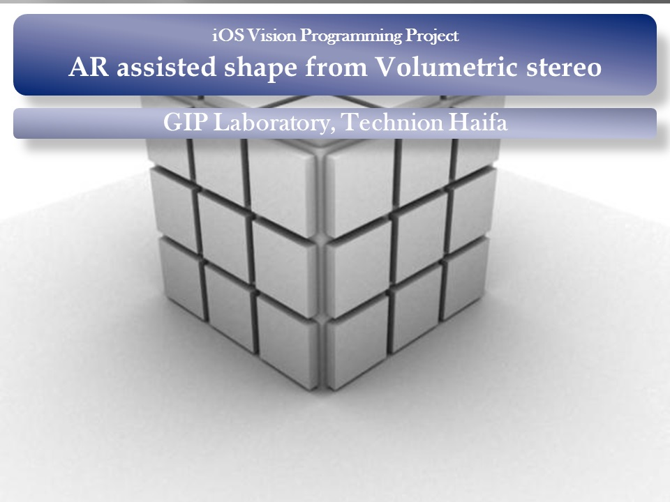

# 3D Volume Carving on iPhone

<p align="center">
  
</p>


This project was designed to reconstruct an object's visual hull from silhouettes and camera poses on an iPhone. The [archived project description](https://twerdster.github.io/#3d-volume-carving-on-iphone) describes a green base/marker, QCAR/Vuforia tracking, voxel carving and marching-cubes meshing. The archive contains part of its C++ geometry code and an updated Python carving component; it does not contain a complete iPhone application.

Students: Sergey Kucher, Alex Povichuk. Supervision: Aaron Wetzler.

*The figure is the original project title slide, unchanged. It is not a reconstruction result.*

## What is available

The [21 original files](source/) preserve geometry, mesh and voxel-sculpting code under `Sculptor/` and a helper header under `Drop Shadows/`. Their contents are unchanged. The Objective-C application shell and tracking integration are absent.

The [updated Python component](updated/) takes a bit-packed voxel grid, 3-by-4 camera projection matrices and byte-valued silhouette maps. It implements the original accurate/fast carving loops and modifies the supplied silhouette masks in place, then exports occupied voxels as an ASCII PLY point cloud. An SVG and [notebook](updated/notebooks/voxel_carving_demo.ipynb) display the synthetic three-silhouette example. Point-cloud export and visualization are new; marching-cubes mesh extraction is not implemented.

## Run the updated component

Python 3.10+ is required; the port uses the standard library. The voxel-grid size must be a multiple of eight from 8 to 128. Run from a checkout:

```sh
cd updated
python3 demo.py --size 24 --radius 8 --out build
python3 -m unittest discover -s tests -v
```

The demo writes `build/synthetic-hull.ply` and `build/synthetic-hull.svg` and prints occupied-voxel counts after each view. The [component guide](updated/README.md) covers notebook/Colab setup, grid restrictions, projection conventions and optional C++ comparison.

## Validation and limitations

The [2026-11-12 record](updated/VALIDATION.json) reports 16 component unit tests and six notebook code cells executed on macOS 15.1.1 arm64 with Python 3.14.4 and Apple clang 16. The tests cover analytic silhouette intersection, occupancy packing, projections, monotonicity, exports and original vector-cache regressions. Three compiler-dependent tests are included in that recorded 16-test run and passed rather than skipped. They compare actual original C++ carving code with the Python port on bounded synthetic inputs; occupancy bits and mutated masks match exactly for those cases. These tests skip when neither clang++ nor g++ is available.

The harness uses a new declaration-only `MarchingCubes.h` stub written for comparison; it is not the absent original header. It provides no `Polygonise` implementation and does not validate meshing. Float32 projection arithmetic and several historical vector-cache quirks are retained; undefined/nonfinite projections receive explicit new handling. These choices and their limits are described in the component guide.

The complete app requires its historical iOS integration, OpenGL ES, compatible QCAR/Vuforia dependencies and camera/tracking resources. Proprietary SDK files and third-party UI material were excluded, and `MarchingCubes.h` is absent pending provenance review. No complete app build, device run, reconstruction benchmark or Linux execution is recorded. All updated example inputs are synthetic, with no recovered captures.

## Original code and updated work

The Python translation was drafted with Claude Code and completed/reviewed/tested with Codex for Aaron Wetzler in 2026. The original files, student credits and third-party notices are preserved. No explicit top-level code license was found, and no blanket license is added for original or derived work. Authors can open an issue to contribute updates, correct attribution or request removal.

## Links

- [Project entry on Aaron Wetzler's website](https://twerdster.github.io/#3d-volume-carving-on-iphone)
