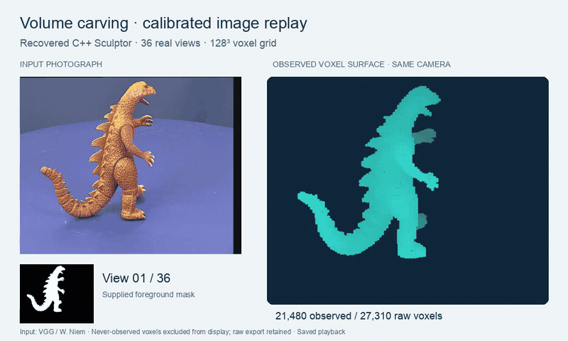

# 3D Volume Carving on iPhone

 

*Boundary samples after the new in-image observation filter, using recovered C++ carving on 36 real dinosaur silhouettes with supplied cameras.*

This iPhone app was meant to reconstruct an object's visual hull from silhouettes and tracked camera poses. Part of its C++ geometry code was recovered. The app shell, tracking integration and marching-cubes implementation were not.

Students: Sergey Kucher, Alex Povichuk. Supervision: Aaron Wetzler. Dinosaur data: Wolfgang Niem, Hannover, via [Oxford VGG](https://www.robots.ox.ac.uk/~vgg/data/mview/) and Ben Tordoff's example.

## Updated

[Open the interactive demo](https://twerdster.github.io/iphone-volume-carving/). It rotates the recorded raw and observed boundary clouds. It does not reconstruct anything, capture images, estimate poses or extract triangles.

The unchanged C++ carver runs through a compatibility header and has no mesh code. Replaying the 36 masks produced 27,310 raw voxels. The observed set has 21,480 voxels and 6,415 boundary points. It excludes voxels that never project inside any image, which is not occlusion reasoning. New iOS, Android, macOS and Linux frontends run the same carver on this fixture. See the [2026-11-14 metrics and logs](updated/validation/2026-11-14/) and the [native run records](updated/validation/native-platforms/).

Requirements: a C++17 compiler and Python 3. The harness uses only the standard library. See [updated/README.md](updated/README.md) and [updated/DETAILS.md](updated/DETAILS.md).

## Original reference

The archival README is preserved in [ORIGINAL_PROJECT_REFERENCE.md](ORIGINAL_PROJECT_REFERENCE.md). The 21 files in the [original source](source/) are unchanged. Each author's dated individual permission is recorded in the reference. No new license is assigned.
