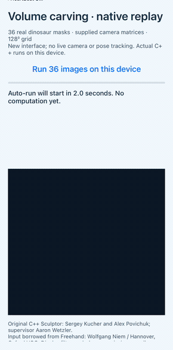
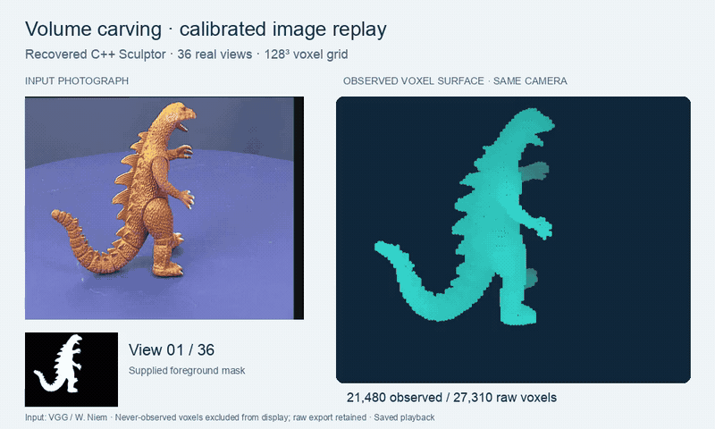

# Silhouette volume carving — updated 2026

## Updated and ported for modern hardware

The recovered C++ carving core runs on macOS and Linux through a compatibility harness, with no numerical carving change for the tested path. New iOS, Android and desktop interfaces replay supplied silhouettes and camera matrices; separate tooling exports boundary points and optionally excludes never-observed voxels. The historical camera/tracking shell and mesh extraction remain absent.

| iPhone 12 · native execution | Offline boundary-point rendering · macOS |
| --- | --- |
|  |  |

The phone runs the new frontend on supplied images and camera matrices; it does
not capture or estimate poses. Recordings: [iOS](assets/ios-native.mp4) ·
[Android](assets/android-native.mp4) · [macOS](assets/macos-native.mp4) ·
[Linux](assets/linux-native.mp4).


Silhouettes and calibrated cameras from a real dinosaur sequence drive the recovered C++ carver. Photographs appear only in the rendering. The display excludes voxels whose projections never fall inside any input image; the unfiltered native output is also retained. [MP4](assets/dinosaur-carving.mp4) · [Full-size image](assets/dinosaur-carving.png) · [Point viewer — download and open locally](assets/dinosaur-viewer.html).

This component runs Sergey Kucher and Alex Povichuk’s `Sculptor` voxel-carving code, supervised by Aaron Wetzler. A voxel is a sample in a regular 3D grid. Each supplied silhouette and 3×4 camera matrix removes samples that project into background. The 21 original files under `../source/` are unchanged.

## New native interfaces

The new [iOS, Android, macOS and Linux interfaces](PLATFORMS.md) execute the
recovered C++ reconstruction on the supplied 36-view fixture, then render its
computed geometry. They use known camera matrices and do not restore live camera
capture or the historical SDK. [Build/runtime/capture records](validation/native-platforms/)
keep executable results separate from recordings and declared platform support.

## What runs

The original C++ carving core compiles on macOS and Linux through a small headless harness. No numerical carving fix was needed for the tested path. Build adaptations provide C++14, `nil=nullptr`, disabled floating-point contraction and a declaration-only replacement for the missing `MarchingCubes.h`. That placeholder does not implement mesh extraction.

The existing standard-library Python translation remains available for small experiments and the notebook. New replay tooling reads real masks and calibrated cameras, exports per-view native occupancy, checks it independently and writes PLY boundary samples. A separate output filter excludes never-observed voxels; it does not change the original carver. No camera app, QCAR/Vuforia integration, texture recovery or triangle meshing is supplied.

## Run

From this directory, the Python core targets 3.10+ (tested on 3.10.12/Linux and 3.14.4/Mac). These commands run tests and a synthetic demo:

```sh
python3 -m unittest discover -s tests -v
python3 demo.py --size 24 --radius 8 --out build
```

The three compiled-original tests require clang++ or g++ and skip when neither exists. Native comparison: `python3 harness/compare_with_original.py`. See [the build/replay guide](RUNNING_2026.md) for original-source compilation, the real dinosaur sequence, sanitizers and the [existing notebook](notebooks/voxel_carving_demo.ipynb). Optional real-data tools use NumPy/Pillow; the small Python core has no dependencies.

## Verified output

On 2026-11-14, all 16 component tests passed on both macOS and Linux, including the three compiled-original comparisons. They cover bounded synthetic occupancy/mask parity, projection, grid packing, order/idempotence checks, exports and retained vector quirks.

The unchanged C++ `ACCURATE` path replayed all 36 dinosaur silhouettes at 128³ resolution, using Freehand’s rounded `demoP` table rather than the original Oxford calibration files. On macOS, all 2,097,152 occupancy values matched a separately written float32 NumPy implementation of the same projection rule after every view. The raw result has 27,310 occupied voxels; 5,830 never project inside any image. Excluding those from the separately labeled observed export leaves 21,480 voxels and 6,415 boundary samples (recomputed after filtering, including newly exposed boundaries). Both raw and observed PLY files are included. [Metrics and logs](validation/2026-11-14/).

The full offline harness replay (not the new C-ABI frontends) exited 0 with no AddressSanitizer/UndefinedBehaviorSanitizer reports on both systems; only executed paths were checked. Linux/GCC ASan output was byte-identical to macOS/clang strict output, including mutated masks and final occupancy. These checks show agreement with the reference on Mac and final-output consistency across the two builds; they do not measure geometric accuracy.

## Limits and credits

The recovered app is incomplete: its Objective-C shell, SDK integration and MarchingCubes implementation are absent. Direct compilation first fails at the missing header. The original out-of-map rule can retain unobserved cells; raw output remains available rather than being silently cleaned. A visual hull cannot recover concavities absent from silhouettes. No held-out-view, physical-capture or reference-surface evaluation was performed.

The input sequence is reused from the separate recovered Freehand project, not recovered captures from this app. Credit: Wolfgang Niem, University of Hannover, via [Oxford VGG’s multi-view data](https://www.robots.ox.ac.uk/~vgg/data/mview/) and Ben Tordoff’s example bundled in the Freehand archive. Existing terms and notices remain; no new dataset or code license is inferred. The earlier Python translation was drafted with Claude Code and completed/tested by Codex. Aaron Wetzler maintains the separately labeled 2026 tooling; original author attribution is preserved.
