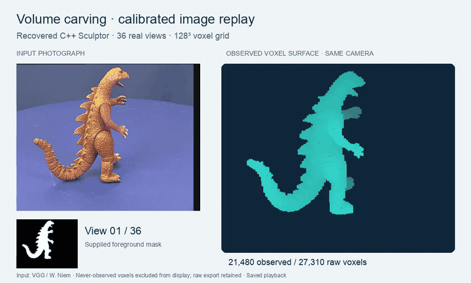

# 3D Volume Carving on iPhone — updated work

<a id="updated-and-ported-for-modern-hardware"></a>

## Updated work

The browser viewer compares the actual exported raw and observed voxel-boundary samples. It is a display of saved carving output, with orbit, slice and color controls. The native fixture applications execute the unchanged carver; this browser viewer does not reconstruct or supply the missing meshing implementation.

**[Run the browser demo](https://twerdster.github.io/iphone-volume-carving/)** · [Browser demo source and local use](../demo/README.md)



## Run locally

The static demo was checked in current Chrome and needs no package installation. From the repository root:

```sh
python3 -m http.server 8000 --directory demo
```

Open http://localhost:8000. The browser displays saved reconstruction output; it does not execute reconstruction.

## Reconstruction implementation

The unchanged C++ carver runs through a compatibility header and has no mesh code. Replaying the 36 masks produced 27,310 raw voxels. The observed set has 21,480 voxels and 6,415 boundary points. It excludes voxels that never project inside any image, which is not occlusion reasoning. New iOS, Android, macOS and Linux frontends run the same carver on this fixture. See the [2026-11-14 metrics and logs](validation/2026-11-14/) and the [native run records](validation/native-platforms/).

Requirements: a C++17 compiler and Python 3. The harness uses only the standard library. See the [detailed implementation, setup and validation guide](DETAILS.md).


[Previous archive README](../ORIGINAL_PROJECT_REFERENCE.md) · [Detailed conversion and validation notes](DETAILS.md) · [Browser data provenance](../demo/provenance.json).
